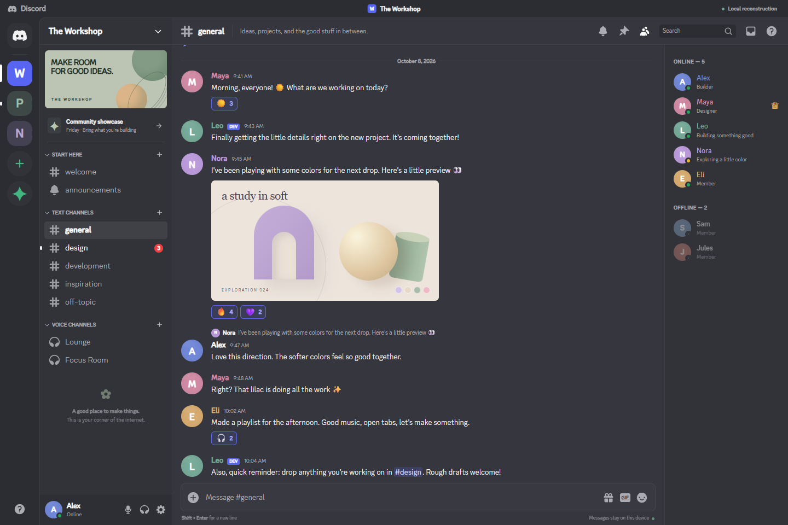
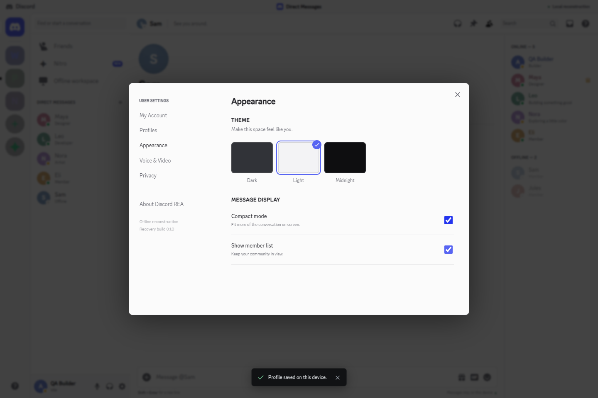
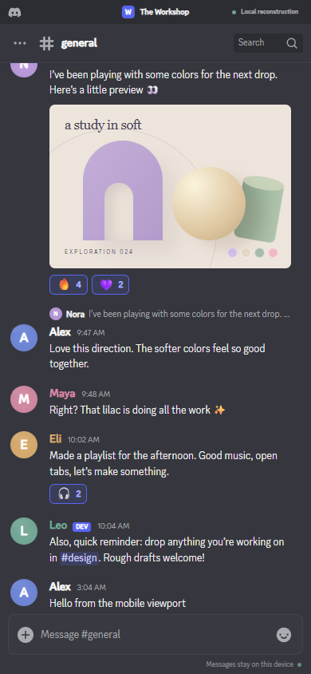

<h1 align="center">Discord REA</h1>
<p align="center">An offline Discord frontend, built to explore how the interface works.</p>



I reconstructed the frontend so you can explore navigation, messages, and settings locally. The app uses synthetic data and saves changes in your browser. No Discord account, token, or backend is needed.

## Run it

Requires Node.js **22.19+** or **24.11+**, and npm.

```sh
git clone https://github.com/antonio-in-stem/discord-rea.git
cd discord-rea
npm ci
npm run dev
```

Open the local address printed by Vite. To create a production build, run `npm run build`, then `npm run preview`.

## Try it

- Switch servers and channels, or open a direct message.
- Send, reply, react, search, and edit or delete your own messages.
- Create a local server or channel, then adjust your profile and theme.

Voice, video, and multiuser synchronization are outside the local demo. The [coverage notes](docs/GAPS.md) explain those limits.

| Light theme | Mobile |
| --- | --- |
|  |  |

## Inside the repo

| Path | Purpose |
| --- | --- |
| [`src/`](src/) | Authored React interface and local state model |
| [`src/extracted/`](src/extracted/) · [`public/extracted/`](public/extracted/) | Reused icons, theme declarations, and fonts |
| [`tests/`](tests/) | Model and browser tests, including network isolation |
| [`scripts/`](scripts/) | Capture, extraction, and source verification tools |
| [`recovered/`](recovered/) | Captured desktop/web artifacts and readable module factories |
| [`evidence/`](evidence/) | Source hashes, module ranges, and visual provenance |

The local app runs authored code. Captured production bundles are retained for inspection and are not executed by the app. Read the [extraction notes](docs/EXTRACTION.md) for the boundary between recovered artifacts and reconstructed behavior.

## Check your changes

```sh
npm test
npm run build
npm run verify:sources
npx playwright install chromium
npm run test:e2e
```

See [contributing](CONTRIBUTING.md). Browser tests check local workflows, responsive layouts, and the absence of external HTTP and WebSocket requests.

## Ownership

Unofficial and unaffiliated with Discord. Recovered code, fonts, icons, and other assets retain their original ownership and notices. No redistribution license for those materials is granted here; review their terms before reuse or publication.
